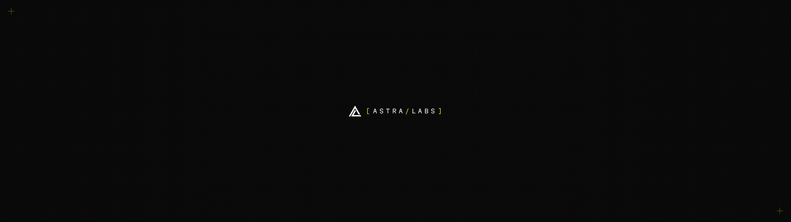
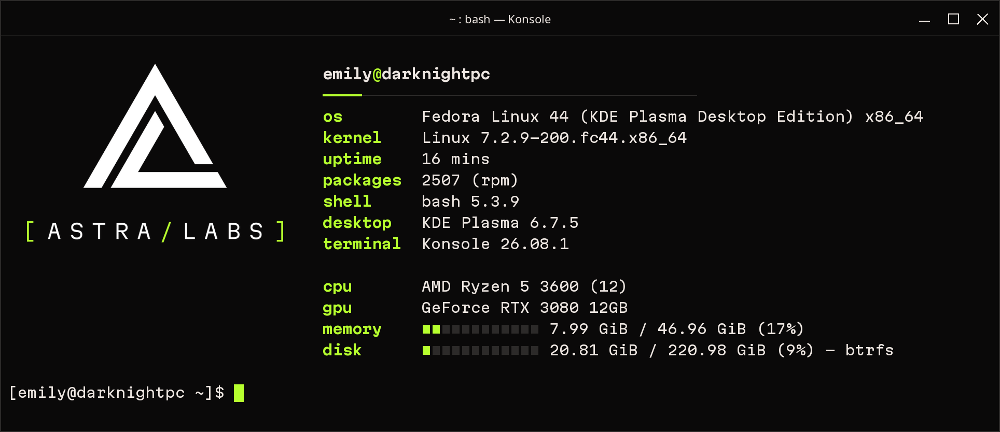
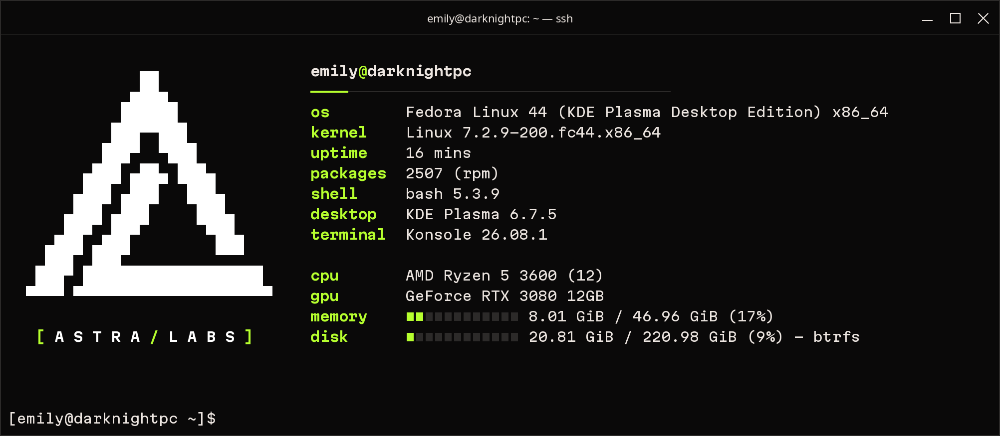
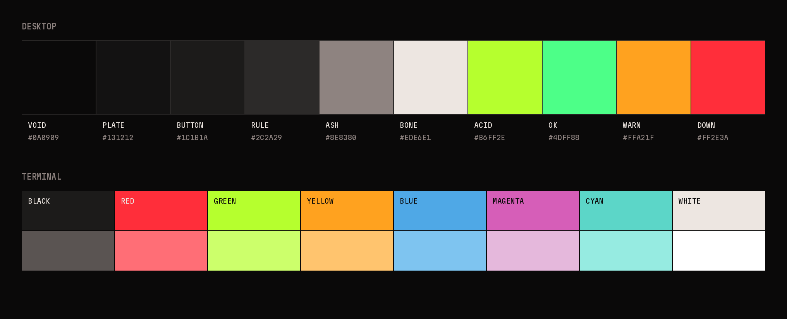

<p align="center">
  
</p>

<h1 align="center">AstraLabs for KDE Plasma</h1>

<p align="center">
  The AstraLabs look for a Fedora KDE desktop: carbon ground, Bone text, Acid for selection and focus.<br>
  Qt and KDE apps, GTK 3/4 and libadwaita apps, Konsole, wallpaper, lock screen and boot splash.
</p>

<p align="center">
  <a href="#install"><b>Install</b></a>
  &nbsp;·&nbsp;
  <a href="#terminal">Terminal</a>
  &nbsp;·&nbsp;
  <a href="#splash-screen">Splash screen</a>
  &nbsp;·&nbsp;
  <a href="#colours">Colours</a>
  &nbsp;·&nbsp;
  <a href="#whats-included">What's included</a>
</p>

<p align="center">
  
</p>

---

## Install

Built for Plasma 6 on Wayland. Everything installs into your home directory; nothing needs root.

```bash
./install.sh
```

This backs up your current settings to `~/.local/share/astralabs-theme/`, installs the files and applies them. Reinstalling keeps that first backup, so uninstalling always returns to the theme you had before.

To install without applying, then pick pieces in System Settings:

```bash
./install.sh --no-apply
```

To undo everything and restore the backup:

```bash
./uninstall.sh
```

---

## Terminal

`astralabs-fetch` runs fastfetch when a terminal opens, with the AstraLabs logo on the left and a system summary on the right: `user@host` over a measurement rule, lowercase keys in Acid, values in Bone, and Acid usage bars for memory and disk.

<table>
  <tr>
    <td width="50%"></td>
    <td width="50%"></td>
  </tr>
  <tr>
    <td><b>Image logo</b> in terminals that can draw images: Konsole, kitty, WezTerm, Ghostty.</td>
    <td><b>Text logo</b> everywhere else, including SSH and tmux: the mark in block characters, the wordmark's brackets and slash in Acid.</td>
  </tr>
</table>

The launcher also falls back to the text logo when the terminal doesn't report its size in pixels, since fastfetch would otherwise swap in the Fedora logo. It runs once per new window or tab, and never in nested shells, scripts or VS Code's terminal.

```bash
astralabs-fetch --text
```

```bash
astralabs-fetch --image
```

To stop it showing on startup, delete `~/.bashrc.d/astralabs-fetch.sh`.

The **Konsole profile** sets the AstraLabs colours, Martian Mono at 9pt with 2px line spacing, and an Acid block cursor. It becomes the default profile. Konsole only reads profiles at startup, so close every Konsole window and reopen it to pick up changes.

---

## Splash screen

<p align="center">
  
</p>

The dot field holds unlit for a moment, then ignites from the centre of the screen in an Acid ring. The mark flickers on like a tube, the wordmark strobes on, and the registration marks set. The last frame matches the wallpaper exactly, so the desktop takes over without a jump. With animations turned off in System Settings, it shows the finished frame.

Preview it without logging out:

```bash
ksplashqml --test --window dev.astralabs.desktop
```

---

## Colours

<p align="center">
  
</p>

| Role | Colour |
|---|---|
| Views (lists, editors, terminal) | Void `#0A0909` |
| Window body, tooltips | Plate `#131212` |
| Buttons | `#1C1B1A` |
| Titlebars and toolbars | Void `#0A0909` |
| Text | Bone `#EDE6E1` |
| Secondary text | Ash `#8E8380` |
| Selection, focus, hover, links | Acid `#B6FF2E`, with Void text on top |
| Positive / neutral / negative | `#4DFF88` / `#FFA21F` / `#FF2E3A` |

The KDE colour scheme drives Breeze widgets, window titlebars and Plasma. kde-gtk-config turns it into GTK 3/4 colours for Breeze GTK, and libadwaita apps get the same palette from a stylesheet imported in `~/.config/gtk-4.0/gtk.css`.

---

## What's included

| Piece | Where it installs | Notes |
|---|---|---|
| `color-schemes/AstraLabs.colors` | `~/.local/share/color-schemes/` | Drives Breeze widgets, window titlebars and Plasma. kde-gtk-config turns it into GTK 3/4 colours for Breeze GTK. |
| `gtk/astralabs-libadwaita.css` | `~/.config/gtk-4.0/` | libadwaita ignores GTK themes, so its named colours are set here and imported from `gtk.css`. |
| `konsole/` | `~/.local/share/konsole/` | Colour scheme and the AstraLabs profile. Set as the default profile. |
| `fastfetch/` | `~/.local/bin/astralabs-fetch`, `~/.config/fastfetch/`, `~/.bashrc.d/` | The terminal summary, its two logos and the startup hook. |
| `fonts/` | `~/.local/share/fonts/AstraLabs/` | Martian Mono variable font (SIL Open Font License). |
| `wallpapers/AstraLabs` | `~/.local/share/wallpapers/` | Dot field with the lockup centred and two registration marks. Used on the desktop and lock screen. |
| `wallpapers/AstraLabs-Field` | `~/.local/share/wallpapers/` | The dot field and registration marks only. |
| `look-and-feel/dev.astralabs.desktop` | `~/.local/share/plasma/look-and-feel/` | Global theme with the AstraLabs splash screen. |

Both wallpapers come in 5120×1440, 3840×1080, 3440×1440, 2560×1080, 3840×2160, 2560×1440, 2560×1600, 1920×1200 and 1920×1080; Plasma picks the closest size.

### Not covered

- **Login screen.** The Plasma Login Manager's wallpaper is set system-wide in System Settings → Login Screen and needs an administrator password.
- **Boot screen (Plymouth).** Needs root and an initramfs rebuild.
- **Square widget corners.** Breeze widgets keep their small rounded corners. Fully square widgets would need Kvantum (`sudo dnf install kvantum`) and a matching Kvantum theme.
- **Flatpak apps.** GTK Flatpaks need `flatpak override --user --filesystem=xdg-config/gtk-4.0:ro` to see the libadwaita colours.

---

## Development

Regenerate the wallpapers (the lockup SVG is in the AstraLabs design repo under `brand/`):

```bash
python3 tools/render_wallpapers.py /path/to/astralabs-lockup.svg
```

Regenerate the README images in `docs/images/`. The terminal shots use live fastfetch output and the splash GIF is captured from the real QML off screen, so this needs fastfetch and ksplashqml installed:

```bash
python3 tools/render_readme_images.py
```

Both scripts need Pillow and CairoSVG; the README script also needs fontTools:

```bash
pip install pillow cairosvg fonttools
```

---

## Licence

Copyright © 2026 Emily Astranova. Licensed under the [GNU Affero General Public License v3.0](LICENSE). Martian Mono is licensed separately under the SIL Open Font License 1.1 (`fonts/OFL.txt`).
